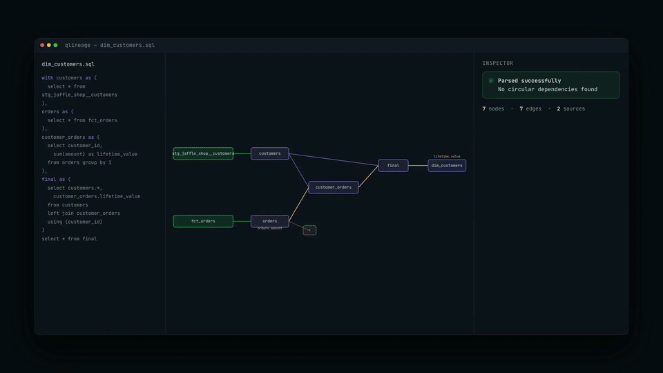
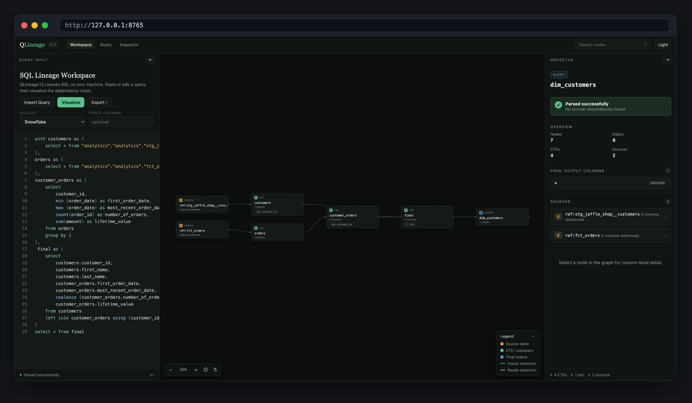
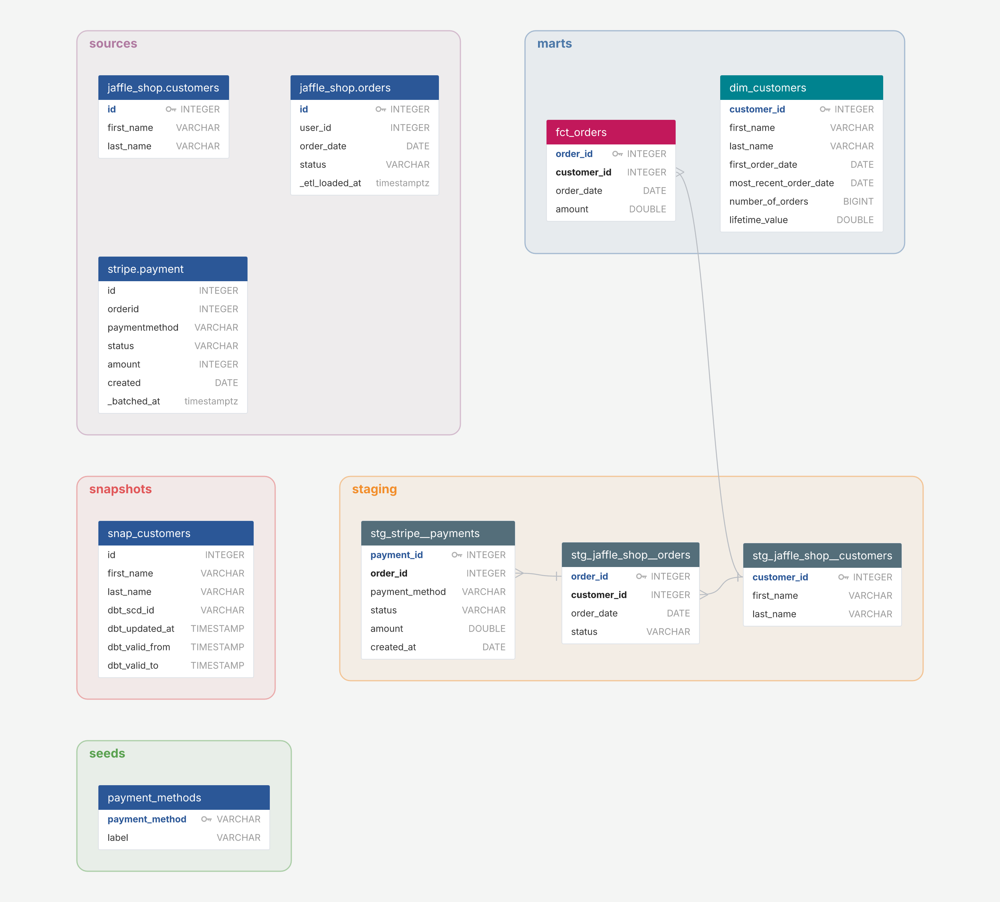
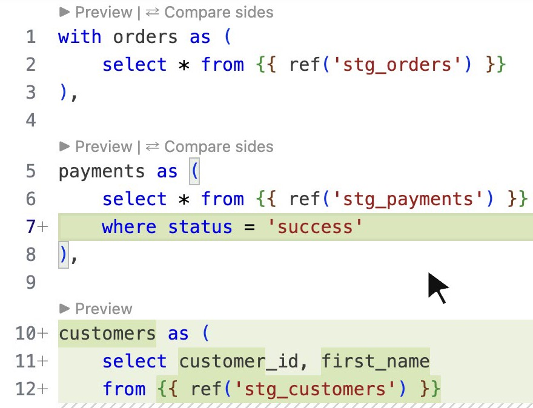

# dbt Fundamentals



[](https://codespaces.new/MarkPhamm/dbt-Fundamental?quickstart=1)

**[Take the interactive lessons](https://markphamm.github.io/dbt-Fundamental/)**: run SQL in your browser, answer quizzes and track your progress, with nothing to install.

Open in Codespaces to skip local setup: Python, dependencies and raw data are installed for you, so you can run `dbt build --profiles-dir .` from `oms_dbt_proj` right away. Local setup below still works.

This is the same dbt project with two targets in `oms_dbt_proj/profiles.yml`. Models, sources, and tests are shared; only the target changes.

- **DuckDB** (`--target duckdb`) — default. Runs locally with no warehouse login. Load raw data with `python duckdb/load_raw.py`, then models land in `duckdb/analytics.duckdb`.
- **Snowflake** (`--target snowflake`) — same models and sources. Load raw data with `snowflake/raw_data.sql`, then set `SNOWFLAKE_ACCOUNT`, `SNOWFLAKE_USER`, and `SNOWFLAKE_PASSWORD`.

From `oms_dbt_proj`:

```sh
dbt build --profiles-dir . --target duckdb
dbt build --profiles-dir . --target snowflake
```

Setup details are in `oms_dbt_proj/README.md`.

## Follow the dbt Fundamentals course

Use this project alongside dbt Learn's free [dbt Fundamentals](https://learn.getdbt.com/courses/dbt-fundamentals) course. The course uses the same jaffle_shop data, so each module maps to files you can open and run here. Run `dbt build --profiles-dir .` once from `oms_dbt_proj` first.

| Module | Open | Run |
|---|---|---|
| [Models](docs/course/models.md) | `models/staging/`, `models/marts/` | `dbt run --profiles-dir .` |
| [Sources](docs/course/sources.md) | `models/staging/*/*_source.yml` | `dbt source freshness --profiles-dir .` |
| [Tests](docs/course/tests.md) | `models/**/*_schema.yml`, `tests/` | `dbt test --profiles-dir .` |
| [Documentation](docs/course/documentation.md) | `models/**/*_doc.md` | `dbt docs generate --profiles-dir .` then `dbt docs serve --profiles-dir .` |
| [Deployment](docs/course/deployment.md) | `.github/workflows/dbt.yml` | runs on every pull request |

Each module page has a **Try it** exercise. Exercises edit the project. To undo one, run `git checkout -- oms_dbt_proj` from the repo root and delete any files the answer created.

## Next steps after Fundamentals

Four short chapters, in the order dbt Learn teaches them. Each one runs offline on DuckDB.

1. [Generic tests on a mart](docs/next-steps/01-generic-tests.md)
2. [Macros, Jinja and packages](docs/next-steps/02-macros-and-packages.md)
3. [Unit tests and CI](docs/next-steps/03-unit-tests-and-ci.md)
4. [Seeds, analyses and snapshots](docs/next-steps/04-seeds-analyses-snapshots.md)

## Tools

Three tools to see what a dbt project does. QLineage and qdbd only read files and never touch the warehouse. CTE Diff runs queries through dbt on the DuckDB target.

<table>
<tr>
<td width="33%"><a href="docs/tools/qlineage.md"></a></td>
<td width="33%"><a href="docs/tools/qdbd.md"></a></td>
<td width="33%"><a href="docs/tools/cte-diff.md"></a></td>
</tr>
<tr>
<td><a href="docs/tools/qlineage.md"><b>QLineage</b></a>: how data flows, model to model and column by column.</td>
<td><a href="docs/tools/qdbd.md"><b>qdbd</b></a>: how tables relate. An ERD built from your dbt tests.</td>
<td><a href="docs/tools/cte-diff.md"><b>CTE Diff</b></a>: which rows a SQL change touches, one CTE at a time.</td>
</tr>
</table>

To query the built models in a browser, use the [DuckDB UI](docs/tools/duckdb-ui.md).

## Reference

- [dbt concepts](docs/notes/dbt-concepts.md): course notes, from ELT and the modern data stack to state.
- [Common dbt commands](docs/notes/commands.md): cheatsheet.
