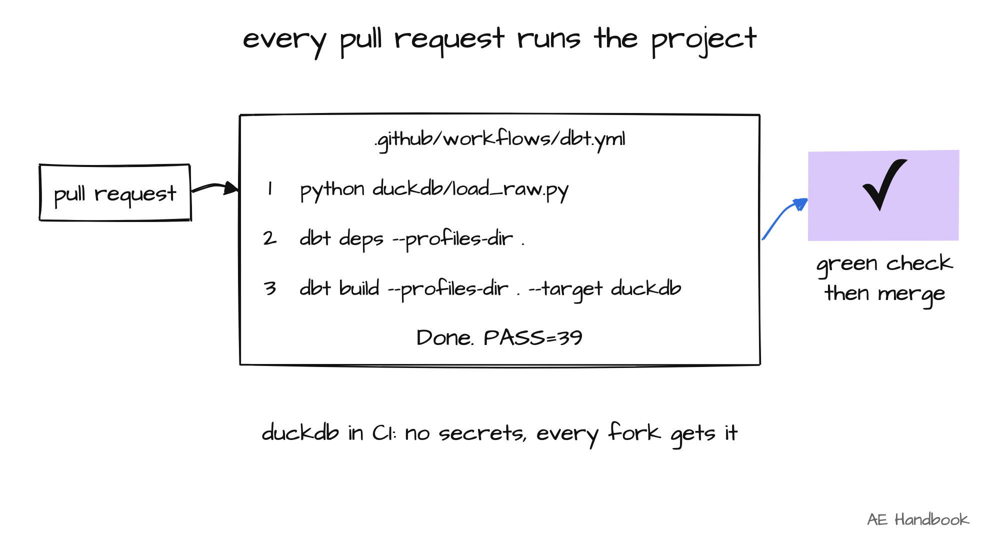

# Deployment

[Course map](../index.md#follow-the-dbt-fundamentals-course) · Previous: [Documentation](documentation.md) · Next: [Next steps after Fundamentals](../index.md#next-steps-after-fundamentals)



The course deploys with dbt Cloud jobs. This repo uses a GitHub Action instead: `.github/workflows/dbt.yml` loads the raw data and runs `dbt build` on every pull request, so a broken model or failing test shows a red check before anyone merges.

| Open | Run |
|---|---|
| `.github/workflows/dbt.yml` | runs on every pull request |

## Learn

- **Development:** you change the project on a branch (for example `feature/customers-model`) and build into your own schema (for example `dbt_jsmith`), so you never touch what others use.
- **Deployment:** dbt runs on a schedule from `main` into a production schema (for example `dbt_prod`), and dashboards read from there. Production gets its own schema and, ideally, its own warehouse account.

In dbt Cloud you set this up on two pages. **Environments** picks the dbt version, branch and credentials. **Jobs** runs commands such as `dbt build` on a schedule or with **Run Now**, and keeps each run's logs and docs.

This repo uses a GitHub Action instead, so every pull request is checked before it reaches `main`.

## Quiz

<div class="quiz" data-answer="3" markdown>

**What runs `dbt build` on every pull request in this repo?**

- A dbt Cloud job
- A cron job on a server
- The GitHub Action in `.github/workflows/dbt.yml`

<details class="success" markdown>
<summary>Answer</summary>

**The GitHub Action.** It loads the raw data, then runs `dbt deps` and `dbt build`. A failing model or test shows a red check on the pull request.

</details>
</div>

<div class="quiz" data-answer="1" markdown>

**Why does CI run on the DuckDB target?**

- DuckDB needs no warehouse or secrets, so CI works on every fork
- Snowflake can't run in GitHub Actions
- DuckDB gives different results, which CI needs

<details class="success" markdown>
<summary>Answer</summary>

**No secrets needed.** The same models and tests run on both targets. DuckDB lets any fork get CI without a Snowflake login.

</details>
</div>

<div class="quiz" data-answer="2" markdown>

**Which schema should production runs write to?**

- Your own development schema, such as `dbt_jsmith`
- A dedicated schema no developer uses, such as `dbt_prod`
- Whichever schema the last developer used

<details class="success" markdown>
<summary>Answer</summary>

**A dedicated schema.** Production gets its own schema and, ideally, its own warehouse account, so development never changes the models dashboards read.

</details>
</div>

## Try it

In your fork, add a step that checks source freshness after the build, and open a pull request to see it run.

<details class="tip" markdown>
<summary>Hint</summary>

Copy the shape of the existing `dbt deps + build` step: a `name`, `working-directory: oms_dbt_proj`, and a `run` line. Put it last.

</details>

<details class="success" markdown>
<summary>Answer</summary>

Add this step to the end of `.github/workflows/dbt.yml`:

```yaml
      - name: Source freshness
        working-directory: oms_dbt_proj
        run: dbt source freshness --profiles-dir .
```

The Action's run on your pull request shows a passing `Source freshness` step. Run `dbt source freshness --profiles-dir .` locally to see the same result.
</details>
