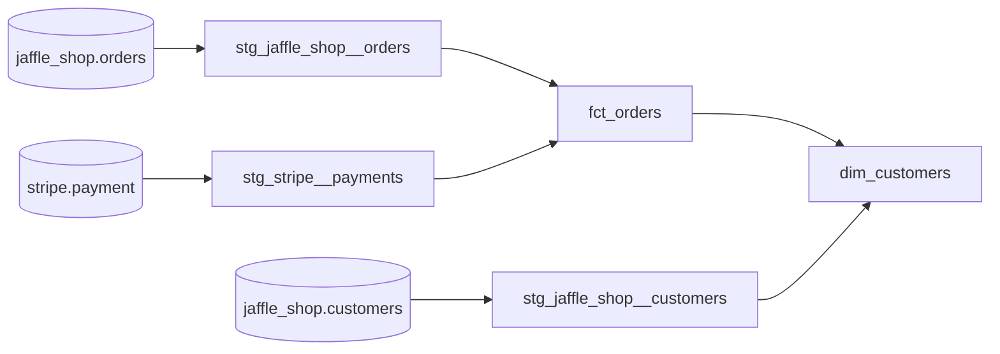

# Models

[Course map](../index.md#follow-the-dbt-fundamentals-course) · Next: [Sources](sources.md)

Staging models rename raw columns; marts join them with `ref()`. `dim_customers` builds on `fct_orders`, which builds on two staging models.

| Open | Run (from `oms_dbt_proj`) |
|---|---|
| `models/staging/`, `models/marts/` | `dbt run --profiles-dir .` |



To trace lineage inside one model, CTE by CTE, use [QLineage](../tools/qlineage.md). To see every table and how the keys join, open the [ERD](../tools/qdbd.md).

Background: [Models](../notes/dbt-concepts.md#models), [Modularity and ref](../notes/dbt-concepts.md#modularity-and-ref), [Naming and project layout](../notes/dbt-concepts.md#naming-and-project-layout).

## Run it in the browser

A model is one `select`. `stg_jaffle_shop__customers` renames `id` to `customer_id`, and dbt compiles its `{{ source('jaffle_shop', 'customers') }}` to `raw.jaffle_shop.customers`. This is the SQL dbt runs for it:

<div class="sql-playground" markdown>

```sql
select id as customer_id, first_name, last_name
from raw.jaffle_shop.customers
```

</div>

`dim_customers` counts each customer's orders. Change the query below to count orders per customer: group by `user_id` and add `count(*) as number_of_orders`. 62 customers have orders.

<div class="sql-playground" data-expect-rows="62" markdown>

```sql
select user_id as customer_id
from raw.jaffle_shop.orders
```

</div>

## Quiz

<div class="quiz" data-answer="2" markdown>

**In this project, what does `dbt run` build for `stg_jaffle_shop__customers`?**

- A table, because every model is a table
- A view, because `dbt_project.yml` sets `+materialized: view` on the staging folder
- Nothing, because staging models only compile

<details class="success" markdown>
<summary>Answer</summary>

**A view.** Materializations are set per folder in `dbt_project.yml`: staging builds views, marts build tables. A `{{ config(materialized='table') }}` block in a model overrides the folder setting.

</details>
</div>

<div class="quiz" data-answer="3" markdown>

**Why does `fct_orders` select from `{{ ref('stg_jaffle_shop__orders') }}` instead of writing the table name?**

- `ref()` makes the query run faster
- Writing the table name is a syntax error in dbt
- dbt reads `ref()` to learn the dependency, builds models in the right order, and fills in the right schema for each target

<details class="success" markdown>
<summary>Answer</summary>

**Dependency, order and target.** Every `ref()` is an edge in the DAG. A hard-coded name still runs, but dbt can't see the dependency, and the name would be wrong on the other target.

</details>
</div>

<div class="quiz" data-answer="1" markdown>

**Where should the join of orders and payments live?**

- In a mart, such as `fct_orders`
- In `stg_stripe__payments`, next to the payment data
- In the source YAML

<details class="success" markdown>
<summary>Answer</summary>

**In a mart.** Staging models map one-to-one to source tables and only rename and cast. Joins and business logic go in marts, built with `ref()` on staging models.

</details>
</div>

## Try it

Add a `full_name` column (first name, a space, last name) to `dim_customers`, then run only that model.

<details class="tip" markdown>
<summary>Hint</summary>

Add the column to the `final` CTE in `models/marts/marketing/dim_customers.sql`. `||` joins strings in both DuckDB and Snowflake. `-s dim_customers` runs one model.

</details>

<details class="success" markdown>
<summary>Answer</summary>

In `models/marts/marketing/dim_customers.sql`, add this line to the `final` CTE, under `customers.last_name,`:

```sql
        customers.first_name || ' ' || customers.last_name as full_name,
```

```sh
dbt run --profiles-dir . -s dim_customers
dbt show --profiles-dir . -s dim_customers --limit 2
```

The output has a `full_name` column, for example `Michael P.`.
</details>
