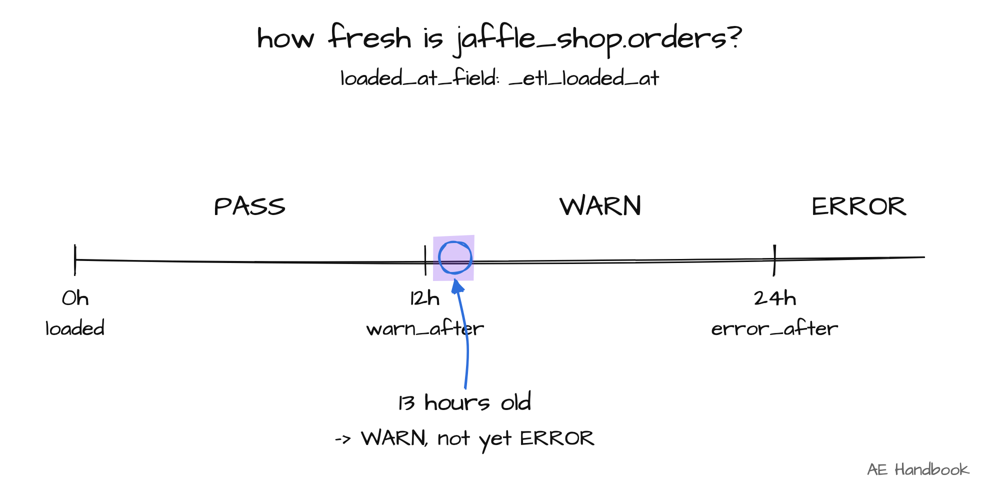

# Sources

[Course map](../index.md#follow-the-dbt-fundamentals-course) · Previous: [Models](models.md) · Next: [Tests](tests.md)



`{{ source('jaffle_shop', 'orders') }}` points at a raw table declared in `stg_jaffle_shop_source.yml`. That file also sets freshness rules on `_etl_loaded_at`, the time `load_raw.py` loaded the data.

| Open | Run (from `oms_dbt_proj`) |
|---|---|
| `models/staging/*/*_source.yml` | `dbt source freshness --profiles-dir .` |

Background: [Sources](../notes/dbt-concepts.md#sources).

## Run it in the browser

`dbt source freshness` runs a query like this one: how long ago was the newest row loaded? The playground loaded the data when you pressed Run, so the answer is close to 0 minutes.

<div class="sql-playground" markdown>

```sql
select
    max(_etl_loaded_at)::timestamp as last_loaded,
    date_diff('minute', max(_etl_loaded_at)::timestamp, current_timestamp::timestamp) as minutes_old
from raw.jaffle_shop.orders
```

</div>

## Quiz

<div class="quiz" data-answer="1" markdown>

**What does `{{ source('jaffle_shop', 'orders') }}` compile to in this project?**

- `raw.jaffle_shop.orders`
- `analytics.jaffle_shop.orders`
- `stg_jaffle_shop__orders`

<details class="success" markdown>
<summary>Answer</summary>

**`raw.jaffle_shop.orders`.** The source YAML sets `database: raw` and `schema: jaffle_shop`, and the table is `orders`. Both targets expose that same name.

</details>
</div>

<div class="quiz" data-answer="2" markdown>

**Orders were last loaded 13 hours ago. The rule is `warn_after: 12 hours`, `error_after: 24 hours`. What does `dbt source freshness` report?**

- PASS
- WARN
- ERROR

<details class="success" markdown>
<summary>Answer</summary>

**WARN.** 13 hours is past the 12-hour warning but inside the 24-hour error threshold.

</details>
</div>

<div class="quiz" data-answer="3" markdown>

**Which column does dbt measure freshness from?**

- The newest `order_date`
- The time `dbt run` last finished
- The `loaded_at_field`, here `_etl_loaded_at`

<details class="success" markdown>
<summary>Answer</summary>

**`loaded_at_field`.** Freshness is about when the loader last wrote data, not about business dates. `load_raw.py` sets `_etl_loaded_at` to the load time.

</details>
</div>

## Try it

Make orders freshness warn after 1 minute, wait 1 minute, and run the freshness check.

<details class="tip" markdown>
<summary>Hint</summary>

The rule lives under the `orders` table in `models/staging/jaffle_shop/stg_jaffle_shop_source.yml`. Change only `warn_after`. `-s source:jaffle_shop.orders` checks one table.

</details>

<details class="success" markdown>
<summary>Answer</summary>

In `models/staging/jaffle_shop/stg_jaffle_shop_source.yml`, change the orders rule to:

```yaml
      warn_after: { count: 1, period: minute }
```

```sh
dbt source freshness --profiles-dir . -s source:jaffle_shop.orders
```

The result is `WARN freshness of jaffle_shop.orders`, because the data is older than 1 minute but younger than the 24-hour `error_after`.
</details>
