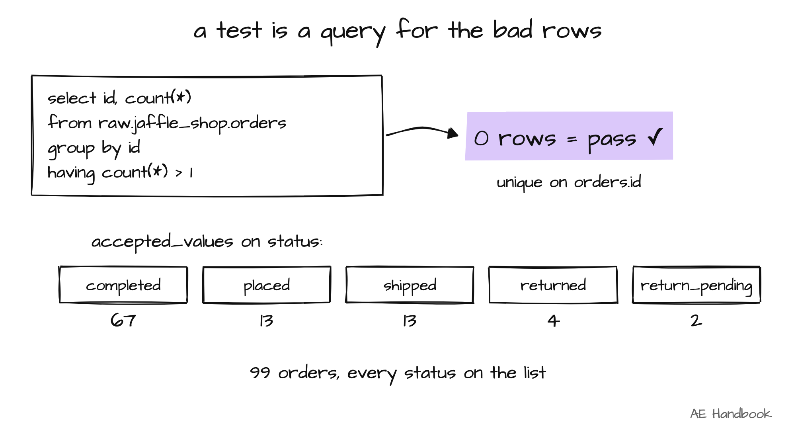

# Tests

[Course map](../index.md#follow-the-dbt-fundamentals-course) · Previous: [Sources](sources.md) · Next: [Documentation](documentation.md)



Generic tests (`unique`, `not_null`, `accepted_values`, `relationships`) live in the `*_schema.yml` files. Singular tests are SQL files in `tests/` that return the rows that break a rule.

Course videos may show `accepted_values` and `relationships` options directly under the test name. dbt 1.10+ expects them under `arguments:`, as this project does.

| Open | Run (from `oms_dbt_proj`) |
|---|---|
| `models/**/*_schema.yml`, `tests/` | `dbt test --profiles-dir .` |

Background: [Testing](../notes/dbt-concepts.md#testing), [dbt build](../notes/dbt-concepts.md#dbt-build).

## Run it in the browser

A test is a query that returns the rows that break a rule. Zero rows means it passes. This is roughly what the `unique` test on order `id` runs:

<div class="sql-playground" data-expect-rows="0" markdown>

```sql
select id, count(*) as n
from raw.jaffle_shop.orders
group by id
having count(*) > 1
```

</div>

Now write the `relationships` test yourself: return every order whose `user_id` has no matching `id` in `raw.jaffle_shop.customers`. It should pass.

<div class="sql-playground" data-expect-rows="0" markdown>

```sql
select orders.*
from raw.jaffle_shop.orders as orders
```

</div>

## Quiz

<div class="quiz" data-answer="2" markdown>

**A dbt test passes when its query returns…**

- exactly one row
- zero rows
- at least one row

<details class="success" markdown>
<summary>Answer</summary>

**Zero rows.** Every test selects the failing rows. No failing rows, no failure.

</details>
</div>

<div class="quiz" data-answer="3" markdown>

**Which generic test catches an order whose `customer_id` doesn't exist in the customers model?**

- `unique`
- `accepted_values`
- `relationships`

<details class="success" markdown>
<summary>Answer</summary>

**`relationships`.** It checks referential integrity: every value must exist in another model's column. `fct_orders.customer_id` has one in `finance_schema.yml`.

</details>
</div>

<div class="quiz" data-answer="1" markdown>

**How is `dbt build` safer than `dbt run` followed by `dbt test`?**

- It tests each model right after building it and skips everything downstream of a failure
- It runs the tests before building anything
- It only builds models that have tests

<details class="success" markdown>
<summary>Answer</summary>

**It stops bad data spreading.** With `run` then `test`, every model is built before any test runs, so downstream models already used the bad data.

</details>
</div>

## Try it

Write a singular test that fails if any customer in `dim_customers` has a negative `number_of_orders`.

<details class="tip" markdown>
<summary>Hint</summary>

A singular test is a `.sql` file in `tests/` that selects the bad rows. Use `{{ ref('dim_customers') }}`, not the table name.

</details>

<details class="success" markdown>
<summary>Answer</summary>

Create `tests/assert_dim_customers_orders_not_negative.sql`:

```sql
select * from {{ ref('dim_customers') }}
where number_of_orders < 0
```

```sh
dbt test --profiles-dir . -s assert_dim_customers_orders_not_negative
```

The test passes: it returns 0 rows.
</details>
