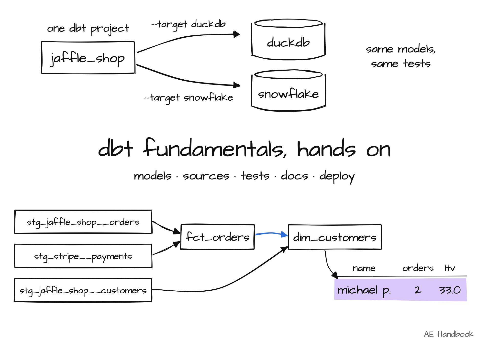
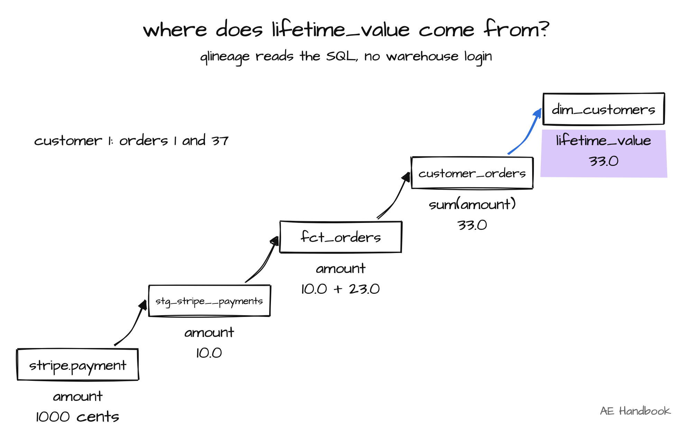
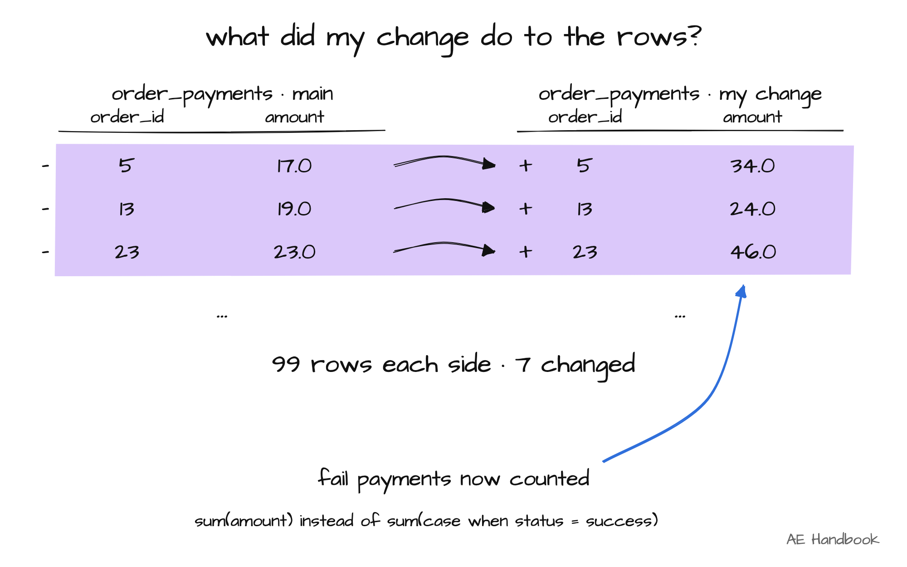

# dbt Fundamentals, hands on



Use this site alongside dbt Learn's free [dbt Fundamentals](https://learn.getdbt.com/courses/dbt-fundamentals) course. The course uses the same jaffle_shop data, so each module maps to files you can open and run in [this repo](https://github.com/MarkPhamm/dbt-Fundamental).

Each lesson has three things to do:

- **Run SQL in your browser.** The playgrounds load the raw jaffle_shop data into DuckDB inside the page. No install, no login.
- **Take the quiz.** Pick an answer and get instant feedback.
- **Do the exercise.** Each **Try it** edits the real dbt project, with a hint and an answer. Mark it done when it works.

Your progress is saved in this browser.

<div class="progress-overall"></div>

## Set up the project

The quizzes and playgrounds need nothing. The exercises need the dbt project:

- **Codespaces:** [open the repo in Codespaces](https://codespaces.new/MarkPhamm/dbt-Fundamental?quickstart=1). Python, dependencies and raw data are installed for you.
- **Local:** Python 3.11+. From the repo root:

```sh
python -m venv .venv && source .venv/bin/activate
pip install -r requirements.txt
python duckdb/load_raw.py
cd oms_dbt_proj
dbt deps --profiles-dir .
dbt build --profiles-dir .
```

Check: the build ends with `Done. PASS=39`.

## Follow the dbt Fundamentals course

| Module | Open | Run | Progress |
|---|---|---|---|
| [Models](course/models.md) | `models/staging/`, `models/marts/` | `dbt run --profiles-dir .` | <span data-progress></span> |
| [Sources](course/sources.md) | `models/staging/*/*_source.yml` | `dbt source freshness --profiles-dir .` | <span data-progress></span> |
| [Tests](course/tests.md) | `models/**/*_schema.yml`, `tests/` | `dbt test --profiles-dir .` | <span data-progress></span> |
| [Documentation](course/documentation.md) | `models/**/*_doc.md` | `dbt docs generate --profiles-dir .` | <span data-progress></span> |
| [Deployment](course/deployment.md) | `.github/workflows/dbt.yml` | runs on every pull request | <span data-progress></span> |

Exercises edit the project. To undo one, run `git checkout -- oms_dbt_proj` from the repo root and delete any files the answer created.

## Next steps after Fundamentals

Four short chapters, in the order dbt Learn teaches them. Each one runs offline on DuckDB.

| Chapter | Progress |
|---|---|
| [1. Generic tests on a mart](next-steps/01-generic-tests.md) | <span data-progress></span> |
| [2. Macros, Jinja and packages](next-steps/02-macros-and-packages.md) | <span data-progress></span> |
| [3. Unit tests and CI](next-steps/03-unit-tests-and-ci.md) | <span data-progress></span> |
| [4. Seeds, analyses and snapshots](next-steps/04-seeds-analyses-snapshots.md) | <span data-progress></span> |

## Tools

<div class="grid" markdown>

[](tools/qlineage.md)

[](tools/qdbd.md)

[](tools/cte-diff.md)

</div>

| Tool | What it shows | Progress |
|---|---|---|
| [QLineage](tools/qlineage.md) | How data flows, model to model and column by column. Reads files only. | |
| [qdbd ERD](tools/qdbd.md) | How tables relate: an ERD built from your dbt tests. Reads files only. | <span data-progress></span> |
| [CTE Diff](tools/cte-diff.md) | Which rows a SQL change touches, one CTE at a time. Runs on DuckDB. | <span data-progress></span> |
| [DuckDB UI](tools/duckdb-ui.md) | The built models, queried in a browser tab. | |

Want to explore the raw data freely? Open the [SQL playground](playground.md).
