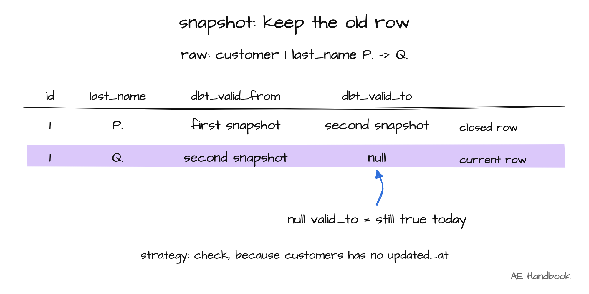

# 4. Seeds, analyses and snapshots

[Next steps](../index.md#next-steps-after-fundamentals) · Previous: [3. Unit tests and CI](03-unit-tests-and-ci.md)



Run the commands from `oms_dbt_proj`, after a first `dbt build --profiles-dir .`.

- `seeds/payment_methods.csv` is small reference data that lives in git and loads with `dbt seed`.
- `analyses/revenue_by_payment_method.sql` joins it to payments. Analyses compile but never build.
- `snapshots/snap_customers.yml` keeps Type 2 history of raw customers.

```sh
dbt compile --profiles-dir . -s revenue_by_payment_method
dbt snapshot --profiles-dir .
python -c "import duckdb; duckdb.connect('../duckdb/raw.duckdb').execute(\"update jaffle_shop.customers set last_name = 'Q.' where id = 1\")"
dbt snapshot --profiles-dir .
dbt show --profiles-dir . --inline "select id, last_name, dbt_valid_from, dbt_valid_to from {{ ref('snap_customers') }} where id = 1"
```

Check: customer 1 has two rows. The `P.` row has a `dbt_valid_to`, and the `Q.` row has none. Run `python duckdb/load_raw.py` from the repo root to reset the raw data.

Background: [Analyses and seeds](../notes/dbt-concepts.md#analyses-and-seeds).

## Try it

Snapshot raw orders, tracking changes to `status` only, then change an order's status and snapshot again.

<details class="tip" markdown>
<summary>Hint</summary>

Copy `snapshots/snap_customers.yml`, point it at the orders source, and use `check_cols` to watch only `status`. The `update` command in the chapter shows how to change raw data.

</details>

<details class="success" markdown>
<summary>Answer</summary>

Create `snapshots/snap_orders.yml`:

```yaml
snapshots:
- name: snap_orders
  relation: source('jaffle_shop', 'orders')
  config:
    unique_key: id
    strategy: check
    check_cols: ['status']
```

```sh
dbt snapshot --profiles-dir . -s snap_orders
python -c "import duckdb; duckdb.connect('../duckdb/raw.duckdb').execute(\"update jaffle_shop.orders set status = 'completed' where id = 1\")"
dbt snapshot --profiles-dir . -s snap_orders
dbt show --profiles-dir . --inline "select id, status, dbt_valid_from, dbt_valid_to from {{ ref('snap_orders') }} where id = 1"
```

Order 1 has a closed `returned` row and a current `completed` row. Run `python duckdb/load_raw.py` from the repo root to reset the raw data.
</details>
