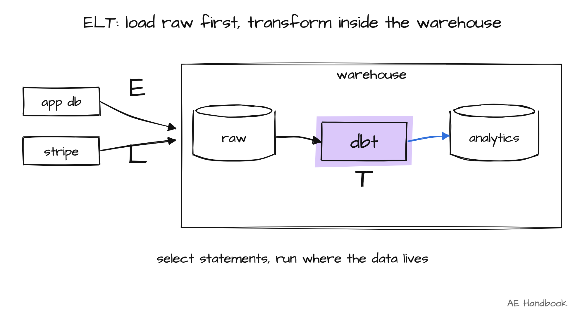
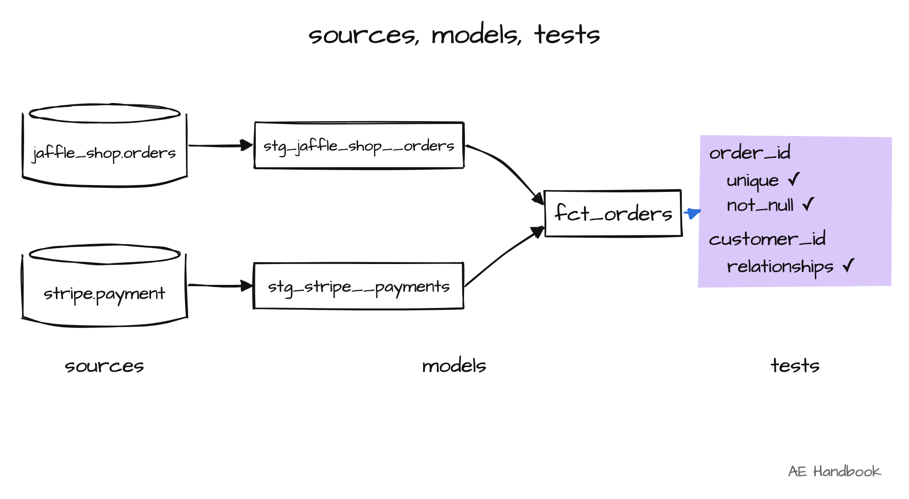
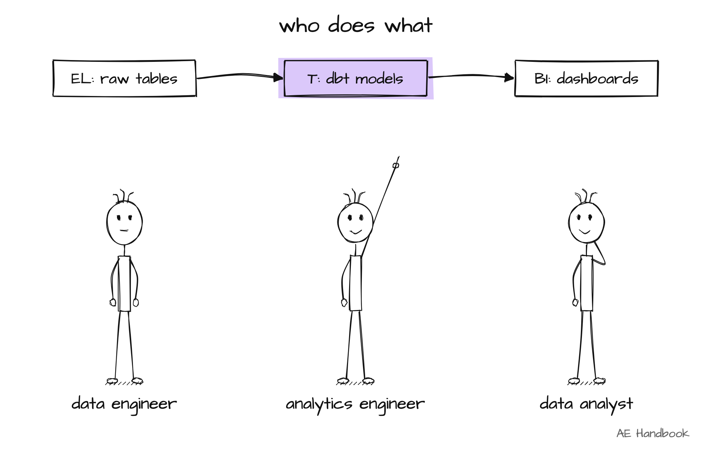
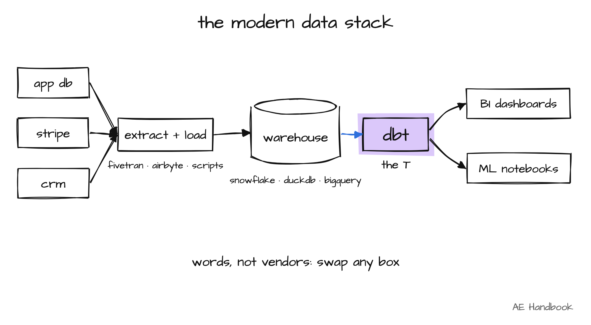
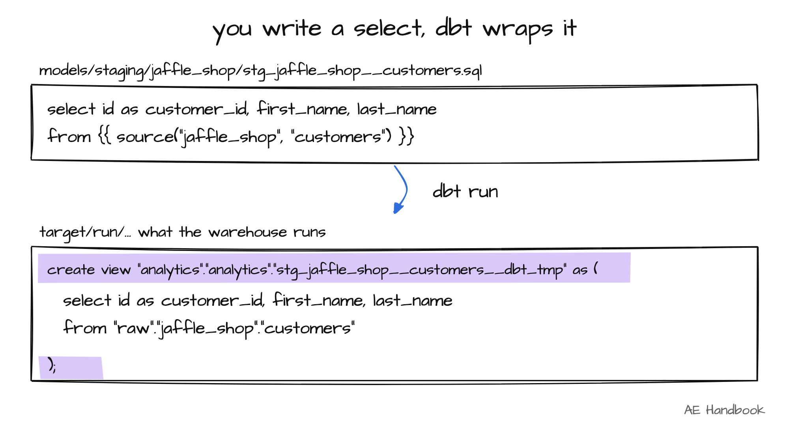
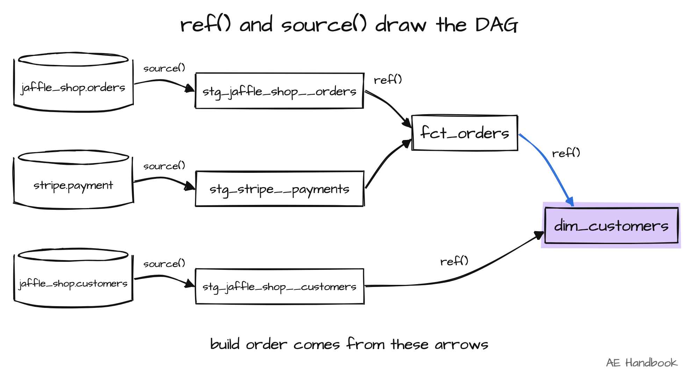
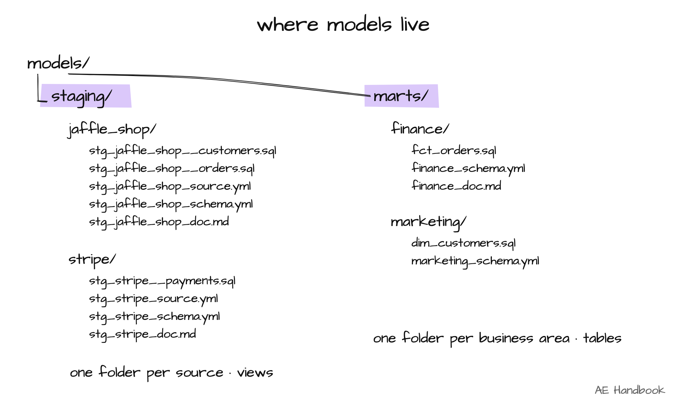

# dbt concepts

[Home](../index.md)

Course notes from dbt Fundamentals. Each [course module](../index.md#follow-the-dbt-fundamentals-course) links to the part it needs.

- [What dbt is](#what-dbt-is)
- [ETL vs ELT](#etl-vs-elt)
- [The modern data team](#the-modern-data-team)
- [The modern data stack](#the-modern-data-stack)
- [Models](#models)
- [Modularity and ref](#modularity-and-ref)
- [Naming and project layout](#naming-and-project-layout)
- [dbt_project.yml](#dbt_projectyml)
- [Sources](#sources)
- [Testing](#testing)
- [dbt build](#dbt-build)
- [Documentation](#documentation)
- [Development vs. deployment](#development-vs-deployment)
- [Analyses and seeds](#analyses-and-seeds)
- [State](#state)

## What dbt is

dbt transforms data inside a data warehouse. It is the "T" in ELT (extract, load, transform). Warehouses include Snowflake, Redshift, BigQuery and Databricks.



Why teams choose dbt:

- **Open source:** dbt Core is free to use.
- **SQL-based:** you write `select` statements, so existing SQL skills are enough.
- **Built for cloud warehouses:** it works with Snowflake, Redshift, BigQuery and Databricks.
- **Engineering practices built in:** version control, automated tests, generated documentation and lineage.
- **One place for the team:** code, tests, docs and deployment live together.

A dbt project has four building blocks:

- **Sources:** raw tables loaded by EL tools such as Fivetran or Python scripts. Green in the lineage graph.
- **Models:** `select` statements. Each model is one table or view in the warehouse. Blue in the lineage graph.
- **Tests:** checks declared in YAML or written as SQL, run against the built models.
- **Documentation:** descriptions in YAML, published as a docs site.

`ref()` links models together, and dbt draws those links as a DAG (directed acyclic graph). The DAG sets the build order and shows lineage.



## ETL vs ELT

- **ETL (extract, transform, load)** extracts data from sources, transforms it on a separate machine, then loads the result into the warehouse.
- **ELT (extract, load, transform)** loads raw data into the warehouse first, then transforms it there.

Cloud warehouses made ELT practical. They separate storage from compute and scale both, so transforming inside the warehouse is cheaper than moving data out and back. ELT brings:

- **Lower cost:** no separate transformation servers.
- **Scale:** the warehouse handles growing volumes.
- **Flexibility:** raw data stays available, so you can change a transformation without reloading.
- **Faster insight:** data is queryable as soon as it lands.
- **Better governance:** keeping raw data makes auditing and tracking easier.

## The modern data team

In a traditional team, **data engineers** own the infrastructure and the ETL, and **data analysts** query the result for stakeholders.

A modern team adds a role in the middle:

- **Data engineer:** extracts and loads raw data into the warehouse (EL).
- **Analytics engineer:** transforms raw data into clean, tested models up to the BI layer (T). This is the dbt role.
- **Data analyst:** builds insights and dashboards on the transformed data.



At a small company one person may hold all three roles. As the team grows, the lines stay blurry.

## The modern data stack

- **Source data:** CRMs, Salesforce, HubSpot and application databases.
- **Extract and load:** Fivetran, Stitch, or Airflow-orchestrated scripts.
- **Data platform:** Snowflake, BigQuery, Redshift, Databricks.
- **Transform:** dbt, with tests, docs and lineage.
- **Consumers:** BI tools (Tableau, Looker, Mode), machine learning notebooks, and operational analytics.



## Models

A model is a `.sql` file in `models/` that holds one `select` statement. You write no DDL or DML: dbt wraps the `select` in the right `create` statement and builds it as a view or table. Each model maps to one object in the warehouse.

- `dbt run` builds the models. The default materialization is a view.
- To build a table instead, put this at the top of the model, or set it per folder in `dbt_project.yml` as this project does:

```sql
{{ config(materialized='table') }}
```

- If the object already exists, dbt replaces it. On BigQuery you may need `dbt run --full-refresh` to switch a view to a table.
- The SQL dbt runs is in `target/run/`, and in the logs.



## Modularity and ref

You could write `dim_customers` as one big query. Modularity splits it into steps instead: stage raw customers and orders first, then build `dim_customers` on top of the staged models. Each step is small, testable and reusable, the way software engineers build applications.

`ref()` joins the steps:

- `{{ ref('stg_jaffle_shop__customers') }}` compiles to the full name of that model in the current target.
- dbt reads every `ref()` to build the DAG, so models always build in the right order.



## Naming and project layout

| Prefix | Meaning |
|---|---|
| `src` | Raw tables loaded into the warehouse. Declared as sources. |
| `stg` | Staging: one model per source table, light cleanup only (rename, cast). Usually views. |
| `int` | Intermediate: steps between staging and marts, built on staging models. |
| `fct` | Facts: things that happened, such as orders, sessions or payments. Long and narrow. |
| `dim` | Dimensions: people, places and things, such as customers or products. |

- **`models/staging/`** holds staging models and source YAML, with a subfolder per source (`jaffle_shop`, `stripe`).
- **`models/marts/`** holds intermediate, fact and dimension models, with a subfolder per business area (`finance`, `marketing`).



## dbt_project.yml

- **name:** the project's identifier, lowercase with underscores (`jaffle_shop` here).
- **profile:** which entry in `profiles.yml` holds the connection.
- **paths:** where dbt looks for models, seeds, tests, macros, snapshots and analyses.
- **clean-targets:** folders `dbt clean` deletes.
- **models:** configs per folder, such as `+materialized: view` for staging and `+materialized: table` for marts. Options are `view`, `table`, `incremental` (process only new rows) and `ephemeral`.
- **require-dbt-version:** optional, pins the dbt versions the project supports.

## Sources

Sources declare the raw tables. You could hard-code `raw.jaffle_shop.customers` in a model, but declaring a source:

- configures all of a source's tables in one place,
- shows them as green nodes in the lineage graph,
- lets `dbt source freshness` check how old the data is.

Sources live in YAML in `models/`. Trimmed from `models/staging/jaffle_shop/stg_jaffle_shop_source.yml`:

```yaml
sources:
  - name: jaffle_shop
    database: raw
    schema: jaffle_shop
    tables:
      - name: customers
      - name: orders
```

In a model, `{{ source('jaffle_shop', 'customers') }}` compiles to `raw.jaffle_shop.customers`. Like `ref()`, it adds the dependency to the DAG.

### Source freshness

Set `loaded_at_field` and `freshness` on a table:

```yaml
      - name: orders
        loaded_at_field: _etl_loaded_at
        freshness:
          warn_after: {count: 12, period: hour}
          error_after: {count: 24, period: hour}
```

`dbt source freshness` then warns or errors when the newest `loaded_at_field` value is older than the threshold. See the [source properties docs](https://docs.getdbt.com/reference/source-properties).

## Testing

Tests check that your SQL produces what you expect. In dbt a test is a `select` that returns the rows that break a rule: zero rows means it passes.

- **Generic tests** are reusable and declared in YAML on a column.
- **Singular tests** are one-off SQL files in `tests/`.
- **Unit tests** check a model's logic against input rows you write.

dbt ships four generic tests:

| Test | Checks |
|---|---|
| `unique` | every value in the column is unique |
| `not_null` | no value is null |
| `accepted_values` | every value is in a given list |
| `relationships` | every value exists in another model's column (referential integrity) |

```sh
dbt test                                 # every test
dbt test --select test_type:generic      # generic tests only
dbt test --select test_type:singular     # singular tests only
dbt test --select dim_customers          # tests on one model
```

In dbt Cloud, test results appear in the IDE during development and in Run History in production. See the [testing docs](https://docs.getdbt.com/docs/build/data-tests).

## dbt build

- `dbt run` then `dbt test`: builds every model first, then tests. If a test fails, the bad data is already built, and downstream models already used it.
- `dbt test` alone checks models that already exist. It builds nothing.
- `dbt build` runs models, tests, seeds and snapshots together in DAG order. It tests each model right after building it, and skips everything downstream of a failure.

## Documentation

Good documentation lets people answer their own questions about data and helps new team members onboard. Docs that live in a separate tool fall behind the code, so dbt keeps them next to the code, in YAML beside the models.

- Describe models, sources and columns with `description:` in the `*_schema.yml` and `*_source.yml` files.
- For longer, formatted text, write a doc block in a `.md` file and reference it with `doc()`.

Doc block, from `models/staging/jaffle_shop/stg_jaffle_shop_doc.md`:

```


One of the following values:

| status         | definition                                       |
|----------------|--------------------------------------------------|
| placed         | Order placed, not yet shipped                    |
| shipped        | Order has been shipped, not yet been delivered   |
| completed      | Order has been received by customers             |
| return pending | Customer indicated they want to return this item |
| returned       | Item has been returned                           |


```

Used in YAML:

```yaml
      - name: status
        description: '{{ doc("order_status") }}'
```

`dbt docs generate` builds the site and `dbt docs serve` opens it. It shows the lineage graph, descriptions, the tests on each column, and each model's SQL.

## Development vs. deployment

**Development** is building and changing the project. You work in a development schema (for example `dbt_jsmith`) on a feature branch (for example `feature/customers-model`), then merge to `main`.

**Deployment** is running dbt on a schedule in a deployment environment. It runs from `main` into a dedicated schema (for example `dbt_prod`), and its models feed dashboards and reports. Separate environments let you keep building without touching production.

In dbt Cloud:

- **Environments page:** create the deployment environment. Pick the dbt version and branch, set warehouse options (such as a dedicated Snowflake warehouse), and enter credentials.
- **Use a separate warehouse account for production**, and a production schema no developer uses.
- **Jobs page:** a job picks an environment, runs one or more commands (for example `dbt build`), and runs on a schedule or with **Run Now**.
- **Job runs:** each run keeps its logs, generated docs, and source freshness results.

This repo deploys with a GitHub Action instead. See the [Deployment module](../course/deployment.md).

## Analyses and seeds

**Analyses** are `.sql` files in `analyses/`. `dbt run` never builds them, but `dbt compile` turns them into plain SQL in `target/compiled/`. Use them for one-off queries, audits and training queries.

**Seeds** are `.csv` files in `seeds/`. `dbt seed` loads them as tables, and models use them with `ref()`.

- Use seeds for small data that rarely changes: country codes, payment method labels, employee IDs.
- Don't use seeds for data that changes often. Load that with an EL tool.

## State

By default dbt is **idempotent** (the same input data gives the same result every run) and **stateless** (each run ignores the previous one).

dbt still writes **artifacts** each run, a point-in-time record of the project:

- `manifest.json`: every resource in the project (models, sources, tests).
- `run_results.json`: the result of the last command.

Two common uses:

1. Build only new or changed models, plus what depends on them:

```sh
dbt run --select state:modified+ --state path/to/prod-artifacts
```

2. Re-run only what failed, with `dbt retry`.
