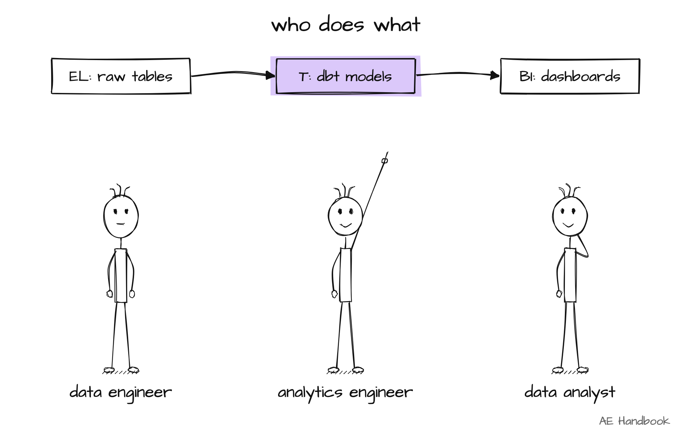
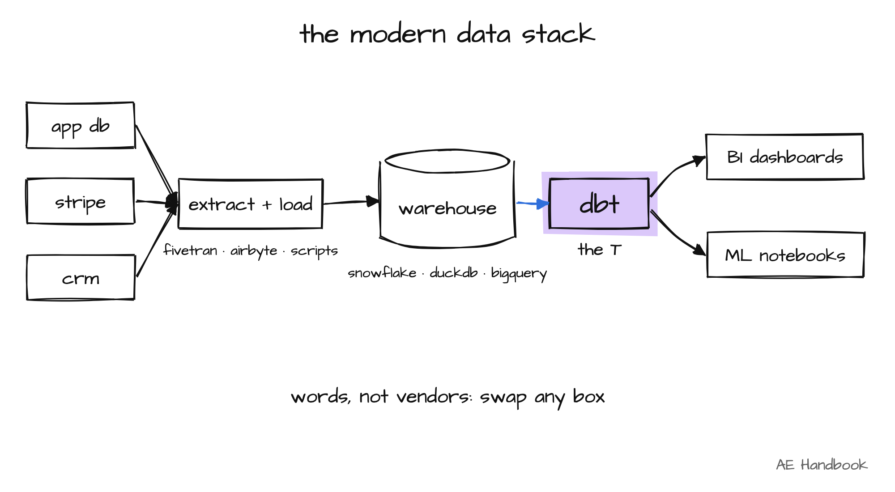

# 1. What is analytics engineering?

[Start here](../index.md#start-here) · Next: [2. ELT and where dbt fits](02-elt-and-dbt.md)

Start here if you have never heard of analytics engineering or dbt. You only need to know a little SQL: `select`, `where`, `join` and `group by`.

## The problem

Every company stores data in the apps it runs. A coffee shop's website keeps **customers** and **orders**. Its payment provider, Stripe, keeps **payments**. Someone in the business then asks a simple question:

> How much has each customer spent with us?

The answer needs all three apps, and their raw data is messy. Amounts are in cents, columns have odd names such as `orderid`, and failed payments sit next to successful ones. Someone has to turn that raw data into clean, trusted tables that answer questions. That work is **analytics engineering**.

## Who does what

- **Data engineer:** gets the raw data out of the apps and into one database (the **warehouse**). This is called extract and load (**EL**).
- **Analytics engineer:** turns raw tables into clean, tested tables (the **T**, for transform). This is the job dbt is built for, and the job this course teaches.
- **Data analyst:** uses the clean tables to answer questions, in dashboards and reports.

At a small company one person often does all three.

## The modern data stack

- **Sources:** the apps that create data: an app database, Stripe, a CRM.
- **Extract and load:** tools such as Fivetran or Airbyte, or plain scripts, copy raw data into the warehouse.
- **Warehouse:** one database for analytics, such as Snowflake, BigQuery or DuckDB. This project runs on DuckDB on your laptop, and on Snowflake.
- **dbt:** transforms raw tables into clean ones, inside the warehouse.
- **Consumers:** dashboards (Tableau, Looker), notebooks and machine learning.

## Quiz

**Which role turns raw tables into clean, tested tables?**

- Data engineer
- Analytics engineer
- Data analyst

Answer

**Analytics engineer.** The data engineer loads the raw data, the analytics engineer transforms it, and the analyst uses the result.

**Where does dbt do its work?**

- In each source app, before the data leaves it
- On the analyst's laptop, after the dashboard loads
- Inside the warehouse, on data that is already loaded

Answer

**Inside the warehouse.** dbt runs SQL in the warehouse on the raw tables the EL tools loaded.

