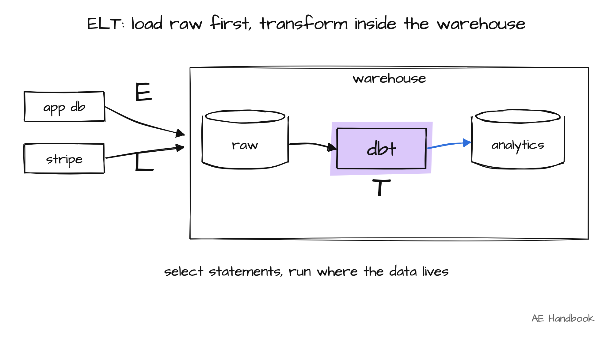

# 2. ELT and where dbt fits

[Start here](../index.md#start-here) · Previous: [1. What is analytics engineering?](01-analytics-engineering.md) · Next: [3. Meet the data](03-meet-the-data.md)

## ETL vs ELT

- **ETL (extract, transform, load):** clean the data on a separate server, then load only the result. If you need a different transformation later, you reload everything.
- **ELT (extract, load, transform):** load the raw data first, then transform it inside the warehouse.

Cloud warehouses made ELT the normal way. They store a lot cheaply and compute fast, so it is easier to keep the raw data and transform it where it lives. ELT gives you:

- **Lower cost:** no separate servers for transformations.
- **Flexibility:** the raw data stays, so you can change a transformation without reloading.
- **Faster answers:** data can be queried as soon as it lands.
- **An audit trail:** you can always trace a number back to the raw rows.

## What dbt is

dbt is the **T** in ELT. You write `select` statements, and dbt turns each one into a table or view in the warehouse, in the right order.

- **SQL only:** if you can write a `select`, you can write a dbt model.
- **Free and open source:** dbt Core is what this repo uses.
- **Works with many warehouses:** this project runs the same code on DuckDB and Snowflake.
- **Software engineering for data:** version control, automated tests, generated documentation and lineage come built in.

dbt never moves data in or out of the warehouse. Loading is the EL tool's job.

## Quiz

**In ELT, what happens to the raw data?**

- It is loaded into the warehouse as is, and transformed there
- It is cleaned first, and only the clean result is loaded
- It stays in the source apps

Answer

**Loaded as is, transformed in the warehouse.** That is the L before the T.

**What do you write to make a dbt model?**

- A Python script that copies tables
- `create table` and `insert` statements
- A `select` statement

Answer

**A `select`.** dbt writes the `create view` or `create table` around it for you. You will see this in lesson 4.

