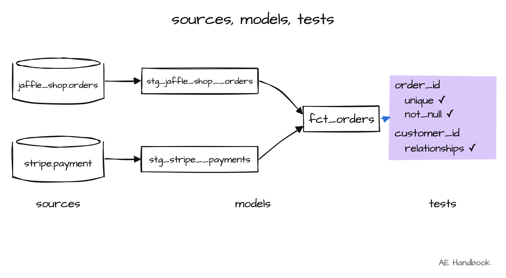

# 3. Meet the data

[Start here](../index.md#start-here) · Previous: [2. ELT and where dbt fits](02-elt-and-dbt.md) · Next: [4. How dbt builds tables](04-how-dbt-builds.md)

The whole course uses **jaffle_shop**, a made-up coffee shop. Its raw data is three tables, already loaded into the warehouse:

| Table | Rows | What one row is |
|---|---|---|
| `raw.jaffle_shop.customers` | 100 | a customer: `id`, `first_name`, `last_name` |
| `raw.jaffle_shop.orders` | 99 | an order: `id`, `user_id` (the customer), `order_date`, `status` |
| `raw.stripe.payment` | 120 | a payment attempt: `orderid`, `status` (success or fail), `amount` in cents |

## Look at it yourself

The box below runs real SQL in your browser. Press **▶ Run**. Then change `orders` to `customers` or `stripe.payment` and run it again.

<div class="sql-playground" markdown>

```sql
select * from raw.jaffle_shop.orders limit 10
```

</div>

Now look at the messy parts. Amounts are in cents, and some payments failed:

<div class="sql-playground" markdown>

```sql
select orderid, status, amount
from raw.stripe.payment
where orderid in (1, 5)
```

</div>

Order 5 has a failed payment of 1700 and a successful one of 1700. If you add them up, you count 34 dollars that were never paid.

## The question we answer

> How much has each customer spent?

The project answers it with a table called `dim_customers`: one row per customer, with their number of orders and `lifetime_value`. Customer 1, Michael P., has 2 orders and a lifetime value of 33.0.

You could write that as one long query. dbt splits it into small steps instead:



- **Sources:** the 3 raw tables, declared once in YAML.
- **Models:** each step is a `select`. Staging models clean one raw table each, `fct_orders` adds up successful payments per order, and `dim_customers` adds up orders per customer.
- **Tests:** checks such as "every `order_id` is unique", run after the build.
- **Documentation:** a description for every table and column, published as a website.

The four [course modules](../index.md#follow-the-dbt-fundamentals-course) cover these four building blocks one by one.

## Quiz

<div class="quiz" data-answer="2" markdown>

**Raw `amount` is 1000. How many dollars is that?**

- 1000
- 10
- 0.1

<details class="success" markdown>
<summary>Answer</summary>

**10.** Stripe stores amounts in cents. The staging model divides by 100.

</details>
</div>

<div class="quiz" data-answer="1" markdown>

**Why does order 5 need care when summing payments?**

- One of its payments failed, so it must not count
- It has no payments at all
- Its amount is negative

<details class="success" markdown>
<summary>Answer</summary>

**A failed payment.** `fct_orders` sums only `status = 'success'`, so order 5 is 17, not 34.

</details>
</div>
