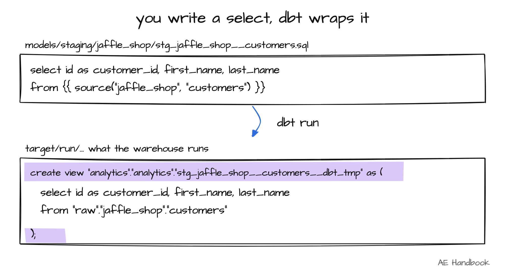
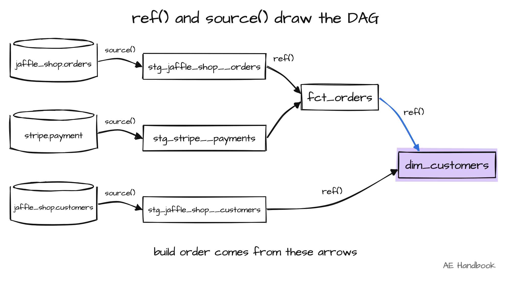

# 4. How dbt builds tables

[Start here](../index.md#start-here) · Previous: [3. Meet the data](03-meet-the-data.md) · Next: [5. Set up the project](05-set-up.md)

## A model is a select

A **model** is one `.sql` file in `models/` that holds one `select`. You never write `create table`. dbt wraps your `select` in the right statement and runs it in the warehouse:



Each model becomes one **view** (a saved query) or one **table** (stored rows). In this project, staging models are views and marts are tables. `dbt_project.yml` sets that per folder:

```yaml
models:
  jaffle_shop:
    staging:
      +materialized: view
    marts:
      +materialized: table
```

## ref() connects the steps

Models build on each other with `ref()`, and on raw tables with `source()`:

```sql
select * from {{ ref('stg_jaffle_shop__orders') }}
select * from {{ source('jaffle_shop', 'orders') }}
```

The `{{ }}` is **Jinja**, a template language. dbt replaces each call with the real table name before running the SQL. It also records every `ref()` and `source()` as an arrow, and those arrows form the **DAG** (directed acyclic graph):



The DAG decides the build order. `fct_orders` always builds before `dim_customers`, because `dim_customers` refers to it.

Splitting the work into small models is called **modularity**. Each step is short, testable and reusable, the way software engineers split a program into functions.

## run, test, build

| Command | What it does |
|---|---|
| `dbt run` | builds every model, in DAG order |
| `dbt test` | runs every test on what is already built |
| `dbt build` | builds and tests together: each model is tested right after it builds, and anything downstream of a failure is skipped |

Use `dbt build` day to day. With `run` then `test`, a bad model has already fed everything downstream before any test runs.

## Quiz

<div class="quiz" data-answer="2" markdown>

**Why does `dim_customers` build after `fct_orders`?**

- Models build in alphabetical order
- `dim_customers` uses `ref('fct_orders')`, so the DAG puts `fct_orders` first
- `fct_orders` is a table and tables always go first

<details class="success" markdown>
<summary>Answer</summary>

**The DAG.** Every `ref()` is an arrow, and dbt builds along the arrows.

</details>
</div>

<div class="quiz" data-answer="1" markdown>

**In this project, what does `dbt run` create for a staging model?**

- A view
- A table
- A CSV file

<details class="success" markdown>
<summary>Answer</summary>

**A view.** `dbt_project.yml` sets `+materialized: view` on `staging`, and `table` on `marts`.

</details>
</div>
