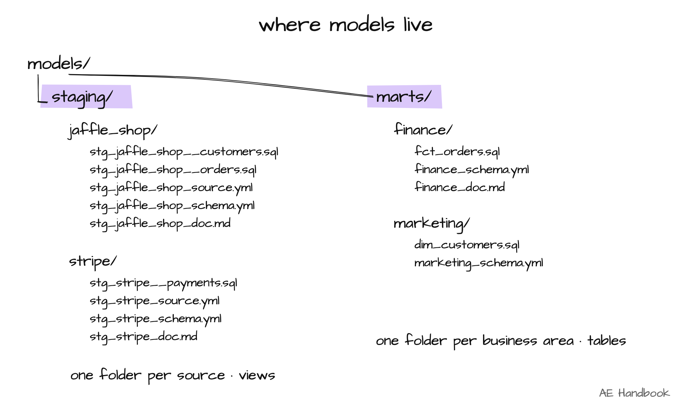

# 5. Set up the project

[Start here](../index.md#start-here) · Previous: [4. How dbt builds tables](04-how-dbt-builds.md) · Next: [Models](../course/models.md)

## Where things live



| Prefix | Meaning |
|---|---|
| `stg_` | **staging:** one model per raw table. Only renames and casts, such as `orderid` to `order_id` and cents to dollars. |
| `fct_` | **fact:** something that happened, such as an order or a payment. |
| `dim_` | **dimension:** a person, place or thing, such as a customer. |
| `int_` | **intermediate:** a step between staging and marts. This project doesn't need one. |

The project lives in `oms_dbt_proj/`. Two files configure it:

- **`dbt_project.yml`:** the project name (`jaffle_shop`), where models live, and views vs tables per folder.
- **`profiles.yml`:** how to connect to the warehouse. It has two **targets**: `duckdb` (the default, a file on your laptop, no login) and `snowflake`. The same models run on both.

## Get it running

Pick one:

- **Codespaces (nothing to install):** [open the repo in Codespaces](https://codespaces.new/MarkPhamm/dbt-Fundamental?quickstart=1). Python, dependencies and raw data are set up for you. Open a terminal in `oms_dbt_proj`.
- **Your laptop:** you need Python 3.11+ and git. From a terminal:

```sh
git clone https://github.com/MarkPhamm/dbt-Fundamental.git
cd dbt-Fundamental
python -m venv .venv && source .venv/bin/activate
pip install -r requirements.txt
python duckdb/load_raw.py
cd oms_dbt_proj
dbt deps --profiles-dir .
```

`load_raw.py` loads the 3 raw tables into `duckdb/raw.duckdb`. `dbt deps` installs the one package the project uses.

Every dbt command in this course runs from `oms_dbt_proj` and ends with `--profiles-dir .`, because `profiles.yml` sits in the project instead of your home folder.

## Try it

Build the whole project: every model and every test.

<details class="tip" markdown>
<summary>Hint</summary>

Lesson 4 named the command that builds and tests together.

</details>

<details class="success" markdown>
<summary>Answer</summary>

```sh
dbt build --profiles-dir .
```

The last line reads `Done. PASS=39 WARN=0 ERROR=0`. dbt built the 5 models, the seed and the snapshot, and ran every test. `dim_customers` now exists in `duckdb/analytics.duckdb`:

```sh
dbt show --profiles-dir . -s dim_customers --limit 3
```

Customer 1, Michael P., shows `number_of_orders` 2 and `lifetime_value` 33.0.
</details>

You are ready for the course. Next: [Models](../course/models.md).
