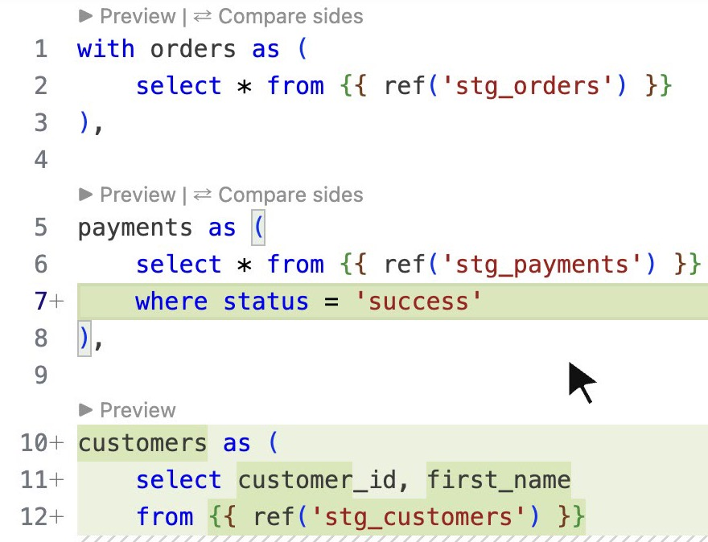
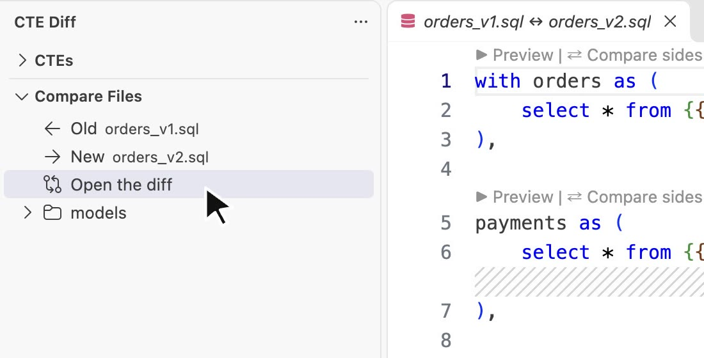

# Compare CTEs with CTE Diff

[Tools](../index.md#tools) · Also: [QLineage](qlineage.md) · [qdbd ERD](qdbd.md)

[CTE Diff](https://ctediff.dev) is a VS Code extension (Cursor too, through Open VSX) that shows what a SQL change did to the data, one CTE at a time. QLineage and qdbd read files. CTE Diff runs queries: it previews the rows a CTE returns, and compares the old and new version of a CTE to list the rows that only one side returns.

Queries go through `dbt show`, so Jinja, `ref()` and the profile behave as in a real run. On this project that means the DuckDB target, with no login.

## Set it up

1. Install it: press Cmd+P (Ctrl+P on Windows and Linux) in VS Code and run `ext install MarkPhamm.cte-diff`. Codespaces installs it for you.
2. Open the repo folder and trust the workspace. CTE Diff stays off in Restricted Mode, because dbt runs project macros.
3. Build once from `oms_dbt_proj`: `dbt build --profiles-dir .`. CTE Diff reads the tables that build creates.
4. Run **CTE Diff: Check Setup** from the Command Palette. It finds dbt in `.venv`, the project in `oms_dbt_proj` and `profiles.yml` beside it, so no settings are needed.

Stop `duckdb/ui.py` first. DuckDB allows one writer per file, and CTE Diff's dbt runs need `analytics.duckdb`.

## Preview a CTE

Open `models/marts/finance/fct_orders.sql`. Every CTE gets a **▶ Preview** lens. Click it above `order_payments` to see that CTE's rows (up to 100, set by `cteDiff.limit`) with the row and column counts.

## Compare a change

There are three ways to get two versions side by side:

- **Compare with Branch…**: your working tree against a branch, for example `main`. The one you will use most.
- **Compare Files**: two SQL files, from the sidebar (above).
- **CTE Diff: New Comparison**: two pasted queries.

In the diff, click **⇄ Compare sides** above a CTE. The result shows each side's row count, how many rows are only on the left (old) or only on the right (new), and then those rows, marked **−** and **+**. Rows with the same id column (`order_id` here) show as an old/new pair with the changed cells highlighted.

Both sides run on your one target, so `ref('stg_stripe__payments')` reads the same table on both sides. The comparison shows what the model's SQL changed, not what another environment holds.

Diff editors hide lenses unless `"diffEditor.codeLens": true` is set. CTE Diff offers to set it the first time a SQL diff opens.

Full docs: [ctediff.dev](https://ctediff.dev).

## Try it

[Chapter 3](../next-steps/03-unit-tests-and-ci.md) breaks `fct_orders` on purpose to make the unit test fail. Make the same change and use CTE Diff to find which orders it changes: in `fct_orders.sql`, change `sum (case when status = 'success' then amount end)` to `sum (amount)`.

Hint

Leave the change uncommitted. **Compare with Branch…** puts `main` on the left and your working copy on the right. The change is in the `order_payments` CTE, so compare that one first.

Answer

With `fct_orders.sql` open, run **CTE Diff: Compare with Branch…** and pick `main`. Click **⇄ Compare sides** above `order_payments`.

Both sides return 99 rows. 7 rows are only on the left and 7 only on the right, shown as 7 pairs: orders 5, 13, 23, 38, 49, 58 and 94. Each of those orders has a failed payment, which the new SQL now counts. Order 5 goes from 17 to 34.

Compare `final` too: the same 7 orders change. Revert with `git checkout -- oms_dbt_proj/models/marts/finance/fct_orders.sql` from the repo root.

