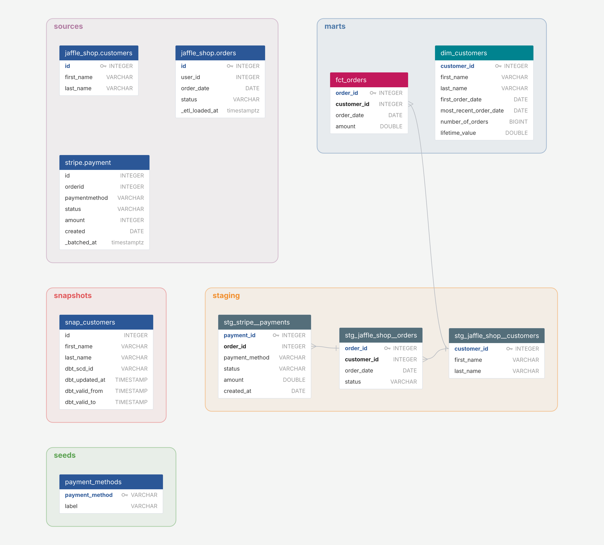

# ER diagrams with qdbd

[Tools](../index.md#tools) · Also: [QLineage](qlineage.md) · [CTE Diff](cte-diff.md)

[qdbd](https://qdbd.dev) (`quickdbd-cli`) draws an entity relationship diagram (ERD) of the project: every table, its columns and types, and how the keys join. QLineage shows how data *flows* from model to model. qdbd shows how tables *relate*, the picture you want before writing a join.

It reads dbt's own files and never connects to a warehouse. Tables come from models, seeds, snapshots and sources. Primary keys come from `unique` + `not_null` tests. Arrows come from `relationships` tests. Column types come from `catalog.json`.



## Generate the ERD

It is already in `requirements.txt` (needs Python 3.11+). Run from `oms_dbt_proj`:

```sh
dbt docs generate --profiles-dir .
qdbd import dbt target/ -o erd/ --infer-fks
```

Check: the import prints `10 tables, 3 relationships (0 inferred)` and writes one schema file per folder in `erd/` (`marts.txt`, `staging.txt`, `sources.txt`, `seeds.txt`, `snapshots.txt`). `dbt docs generate` writes `catalog.json`, which gives the column types. `erd/` is gitignored: regenerate it after any model or YAML change.

`--infer-fks` also links `<entity>_id` columns to the table named after the entity when no test declares the link. Here every link already has a `relationships` test, so it infers none.

## Look at it

```sh
qdbd serve erd/                                 # live diagram in the browser, reloads on save
qdbd build erd/ -o erd.html                     # one searchable HTML page you can share
qdbd export erd/ --by-group -o erd.png          # the image above; .svg and .drawio work too
```

`--by-group` draws a shaded region per dbt folder. Press Ctrl+C to stop `qdbd serve`.

## Find a join path

`qdbd path` finds the shortest chain of joins between two tables and prints the SQL:

```sh
qdbd path erd/ --from stg_stripe__payments --to stg_jaffle_shop__customers
```

```
stg_stripe__payments -> stg_jaffle_shop__customers: 2 join(s)
  stg_stripe__payments.order_id -> stg_jaffle_shop__orders.order_id (N:1)
  stg_jaffle_shop__orders.customer_id -> stg_jaffle_shop__customers.customer_id (N:1)

FROM stg_stripe__payments
JOIN stg_jaffle_shop__orders ON stg_jaffle_shop__orders.order_id = stg_stripe__payments.order_id
JOIN stg_jaffle_shop__customers ON stg_jaffle_shop__customers.customer_id = stg_jaffle_shop__orders.customer_id
```

## More

- Teams usually commit the schema files. Then `qdbd diff --base origin/main erd/` shows how the schema changed against a branch, and the [GitHub Action](https://qdbd.dev/github-action/) posts that diff on pull requests.
- `qdbd mcp` serves the schema to AI agents. Add it to Claude Code with `claude mcp add qdbd -- qdbd mcp`.
- The [VS Code extension](https://marketplace.visualstudio.com/items?itemName=MarkPhamm.quickdbd) previews schema files in the editor.

Full docs: [qdbd.dev](https://qdbd.dev).

## Try it

`dim_customers` sits alone in the marts region: nothing links it to the rest. Add a `relationships` test from `dim_customers.customer_id` to `stg_jaffle_shop__customers`, then regenerate the ERD and find the join path from `dim_customers` to `stg_stripe__payments`.

<details class="tip" markdown>
<summary>Hint</summary>

`fct_orders.customer_id` already has the test you need in `finance_schema.yml`. qdbd reads the manifest, and `dbt test` rewrites it, so run the test before the import.

</details>

<details class="success" markdown>
<summary>Answer</summary>

In `models/marts/marketing/marketing_schema.yml`, add this under `- not_null` in the `customer_id` tests:

```yaml
    - relationships:
        arguments:
          to: ref('stg_jaffle_shop__customers')
          field: customer_id
```

```sh
dbt test --profiles-dir . -s dim_customers
qdbd import dbt target/ -o erd/ --infer-fks
qdbd path erd/ --from dim_customers --to stg_stripe__payments
```

The new `relationships_dim_customers_customer_id...` test passes. The import prints `10 tables, 4 relationships (0 inferred)`, and `qdbd path` finds 3 joins: `dim_customers` to `stg_jaffle_shop__customers` (1:1), to `stg_jaffle_shop__orders` (1:N), to `stg_stripe__payments`.
</details>
