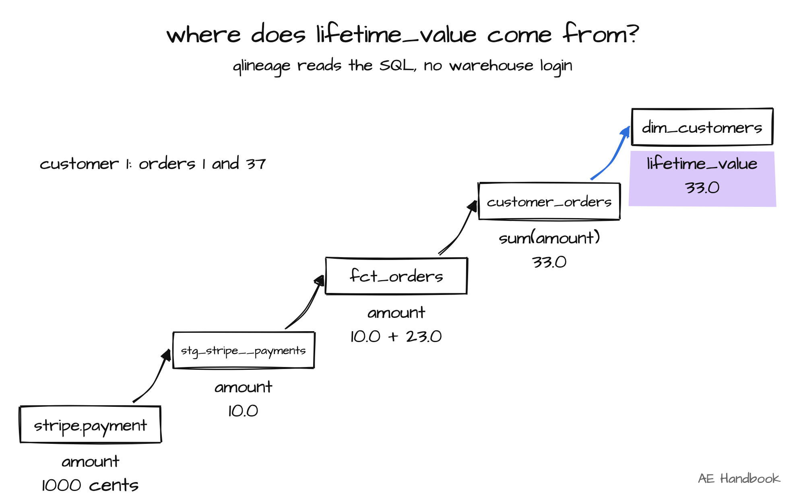
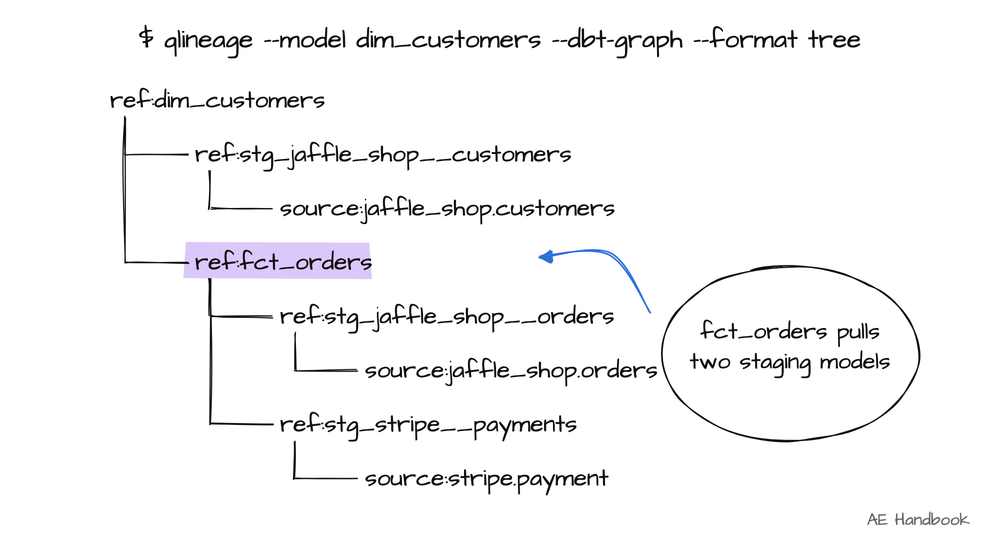
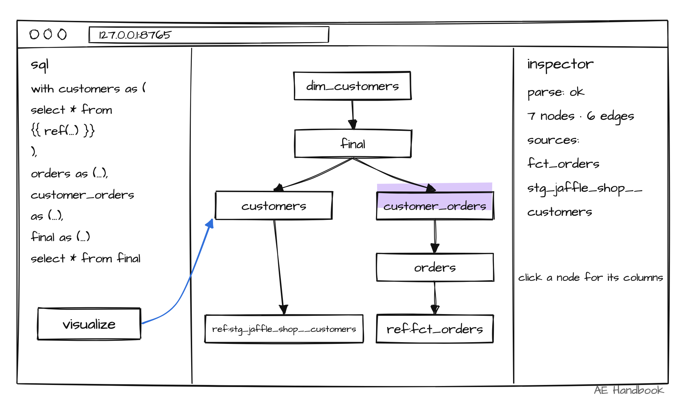
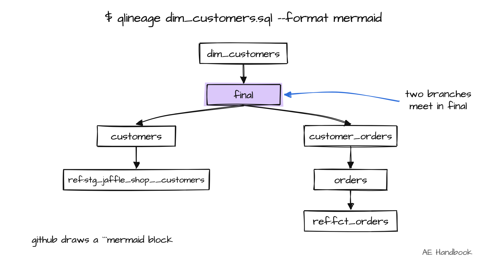

# Lineage with QLineage

[Tools](../index.md#tools) · Also: [qdbd ERD](qdbd.md) · [CTE Diff](cte-diff.md)



[`qlineage-cli`](https://pypi.org/project/qlineage-cli/) reads lineage out of this project without connecting to a warehouse. It parses SQL locally with SQLGlot and picks up `target/manifest.json` when it exists, so it works against the DuckDB target, the Snowflake target, or no target at all.

It is already in `requirements.txt`:

```sh
uv pip install -r requirements.txt
```

Compile first so the manifest exists, then run everything from `oms_dbt_proj`:

```sh
cd oms_dbt_proj
dbt compile --profiles-dir .
```

Without a manifest `qlineage` falls back to parsing `ref()` and `source()` out of the raw SQL, which still works but cannot resolve sources or follow the DAG past the first hop.

## Terminal output

`--dbt-graph` walks the model DAG back to sources, and `--column` traces a single column through the CTEs:

```sh
qlineage --model dim_customers --dbt-graph --format tree
qlineage models/marts/marketing/dim_customers.sql --column lifetime_value --format tree
```



Passing a file path instead of `--model` shows the CTE structure inside that one model rather than the project DAG.

The `*` leaves under `orders.amount` are expected. Our staging models use `select *`, and with no live warehouse connection there is no schema to expand the star against, so the column trace stops there.

## Browser workspace

Passing a SQL file with no `--format` starts a local server on `127.0.0.1` and opens the workspace:

```sh
qlineage models/marts/marketing/dim_customers.sql
```



The left pane holds the compiled SQL and re-parses when you edit and press Visualize. The canvas pans and zooms. The inspector on the right reports parse status, node and edge counts, output columns, and the sources feeding the model; selecting a node drills into its columns and join keys. The workspace also exports SVG, PNG, and JSON. Press Ctrl+C in the terminal to stop the server.

Use `qlineage ui` for a blank workspace to paste ad-hoc SQL into, and `--port` if 8765 is taken.

## Mermaid for docs

`--format mermaid` prints a diagram you can paste straight into a markdown file:

```sh
qlineage models/marts/marketing/dim_customers.sql --format mermaid
```



GitHub renders a fenced ` ```mermaid ` block natively. For the same preview inside Cursor or VS Code, install the `bierner.markdown-mermaid` extension and open the preview with Cmd+Shift+V. To turn a diagram into an image file instead:

```sh
npx @mermaid-js/mermaid-cli -i lineage.mmd -o lineage.png -b white -s 3
```

## Useful flags

| Flag | Description |
|------|-------------|
| `--model <name>` | Select a dbt model by name; works without a file path |
| `--dbt-graph` | Show the recursive model and source DAG instead of CTE lineage |
| `--column <name>` | Trace one output column through the query |
| `--format tree\|json\|mermaid\|html` | `html` opens the workspace; the rest print to the terminal |
| `--dialect snowflake\|redshift` | Parser dialect, defaults to `snowflake` |
| `--depth N` | Cap how far `--dbt-graph` walks |
| `--manifest <path>` | Point at a manifest explicitly instead of auto-discovering |
| `--no-dbt` | Ignore the manifest and parse the raw SQL only |
| `-o, --output <path>` | Write the rendered lineage to a file instead of stdout |
| `--version` | Print the installed version (added in 0.2.2) |
